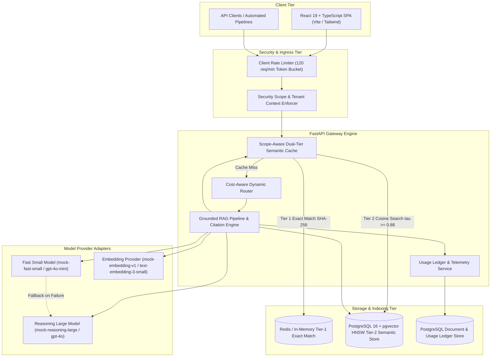
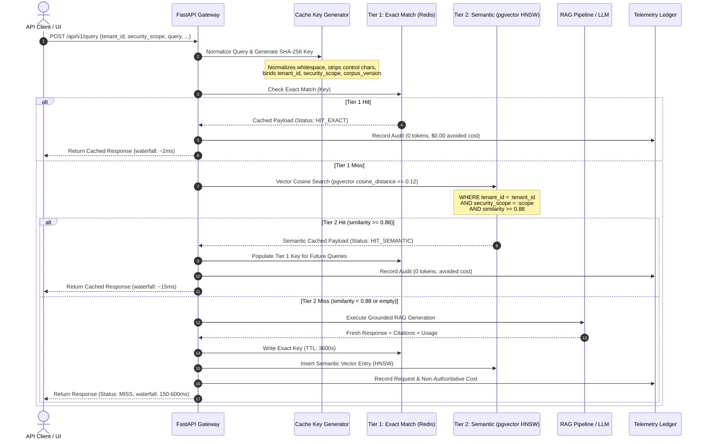
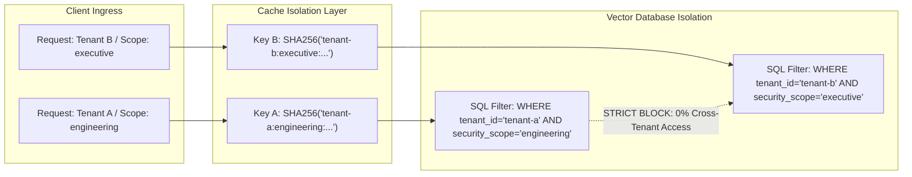

# CachePilot Architecture & Workflow Diagrams

This document outlines the architecture, component interaction flow, cache decision engine, and dynamic model routing decision tree for **CachePilot (CPilot)**.

---

## 1. System Architecture & Topology

CachePilot sits as a reverse proxy / AI gateway between frontend client applications and backing model providers or vector databases.

---

## 2. Dual-Tier Semantic Caching Sequence & Decision Engine

CachePilot employs a deterministic, zero-cross-tenant cache strategy. Every incoming query passes through query normalization and scope isolation before any cache lookup or vector distance calculation is performed.

---

## 3. Cost-Aware Dynamic Routing Flowchart with Fallback Recovery

Queries are classified by complexity based on query length, structural tokens, and multi-signal semantic triggers (comparative, analytical, and quantitative).

```mermaid
flowchart TD
    Start(["Incoming Query: POST /api/v1/query"]) --> Norm["Normalize Query & Extract Features"]
    Norm --> LengthCheck{"Query Length > 180 chars?"}
    
    LengthCheck -- Yes --> AddLen["+0.25 Complexity Score"]
    LengthCheck -- No --> EvalTriggers["Evaluate Semantic Triggers"]
    AddLen --> EvalTriggers

    EvalTriggers --> CompCheck{"Comparative Triggers?<br/>(compare, versus, difference, pros and cons)"}
    CompCheck -- Match Found --> AddComp["+0.40 first match (+0.15 additional)"]
    CompCheck -- None --> AnalCheck{"Analytical Triggers?<br/>(why, analyze, reason, explain step-by-step)"}
    AddComp --> AnalCheck

    AnalCheck -- Match Found --> AddAnal["+0.35 first match (+0.15 additional)"]
    AnalCheck -- None --> QuantCheck{"Quantitative Triggers?<br/>(calculate, sum, average, ratio, percent, audit)"}
    AddAnal --> QuantCheck

    QuantCheck -- Match Found --> AddQuant["+0.40 first match (+0.15 additional)"]
    QuantCheck -- None --> ComputeScore["Compute Total Complexity Score & Clamp [0.0, 1.0]"]
    AddQuant --> ComputeScore

    ComputeScore --> ThresholdCheck{"Score >= 0.65?"}
    
    ThresholdCheck -- "Yes (High Complexity)" --> RouteLarge["Select: mock-reasoning-large<br/>Reason: REASONING_REQUIRED<br/>Cost: $0.005 / 1k tokens"]
    ThresholdCheck -- "No (Low/Medium)" --> RouteSmall["Select: mock-fast-small<br/>Reason: LOW_COMPLEXITY_DIRECT<br/>Cost: $0.0005 / 1k tokens"]

    RouteSmall --> ExecuteSmall["Invoke Small Model Adapter"]
    ExecuteSmall --> SmallSuccess{"Inference Succeeded?"}
    
    SmallSuccess -- Yes --> ReturnSuccess(["Return Generated Grounded Answer"])
    SmallSuccess -- "No (5xx / Timeout / Rate Limit)" --> FallbackLog["Log Router Recovery Event<br/>Update Reason: FALLBACK_RETRY"]
    
    FallbackLog --> RouteLarge
    RouteLarge --> ExecuteLarge["Invoke Large Model Adapter"]
    ExecuteLarge --> ReturnSuccess
```

---

## 4. Multi-Tenant Security & Scope Boundaries

